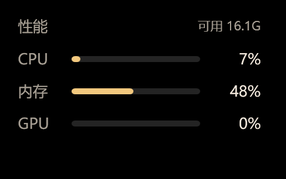

# 此刻 · 性能监视（PerfWidget）

> 透明浮层，实时盯住 CPU / 内存 / GPU；点一下内存，直接跳到联想电脑管家清理。

和「此刻 · 桌面时钟」「此刻 · 待办清单」同一套视觉语言：无边框、透明背景、米白细体、右键菜单。



<sub>黑色部分是透明区域，实际会浮在壁纸上。</sub>

## 特性

- **三行实时指标**：CPU、内存、GPU 占用百分比 + 细条进度。
- **一点直达**：点「内存」行打开联想电脑管家（清理内存）；点 CPU / GPU 行打开任务管理器。
- **悬停有提示**：鼠标移到哪一行，底部就显示这一行能干什么。
- **占用越高越显眼**：超过 75% 变琥珀色，超过 90% 变珊瑚红。
- **轻量**：CPU / 内存用系统 API 直接读（毫秒级），GPU 用系统自带 `nvidia-smi` 异步读取，不卡界面。
- **三种外观**：透明（默认）/ 深色玻璃 / 浅色玻璃；四档尺寸、四档不透明度。
- **桌面级**：可沉到底层、可开机自启，不占任务栏、不进 Alt+Tab，单实例。
- **零依赖**：Windows 自带的 PowerShell + WPF，不用装任何库。

## 快速开始

1. 下载/复制本文件夹。
2. 双击 **`启动性能.bat`**。

想要桌面快捷方式（或顺便开机自启）：

```powershell
powershell -NoProfile -ExecutionPolicy Bypass -File .\Setup.ps1
# 连同开机自启：
# powershell -NoProfile -ExecutionPolicy Bypass -File .\Setup.ps1 -Autostart
```

## 操作

| 操作 | 效果 |
| --- | --- |
| 点「内存」行 | 打开联想电脑管家（清理内存） |
| 点「CPU / GPU」行 | 打开任务管理器 |
| 拖动 | 移动位置（自动记住） |
| 滚轮 | 调整整体不透明度 |
| 右键 | 菜单：立即刷新 / 打开电脑管家 / 任务管理器 / 主题 / 尺寸 / 透明度 / 置于底层 / 开机自启 / 复位 / 退出 |

## 数据从哪来

| 指标 | 方式 | 说明 |
| --- | --- | --- |
| CPU | `GetSystemTimes`（kernel32） | 两次采样差值算占用，几乎零开销 |
| 内存 | `GlobalMemoryStatusEx`（kernel32） | 直接给占用百分比和可用容量 |
| GPU | `nvidia-smi --query-gpu=utilization.gpu` | 后台异步调用，每秒一次；没有 N 卡时自动隐藏 GPU 行 |

> 每秒刷新一次。GPU 这一行只有装 NVIDIA 驱动（自带 nvidia-smi）才显示。

## 文件

```
perf-widget/
├─ PerfWidget.ps1        # 主程序
├─ 启动性能.bat           # 双击启动
├─ Setup.ps1             # 生成快捷方式 / 开机自启
├─ perf.ico / perf.png   # 图标
├─ preview.png           # 效果预览
├─ README.md
└─ LICENSE
```

运行时生成（已加入 `.gitignore`）：

- `perf-settings.json`：位置、主题、尺寸等
- `perf.log`：出错日志（正常为空）

## 自定义

- 采样间隔：`PerfWidget.ps1` 里 `$script:Timer.Interval`（默认 1500ms）。
- 阈值配色：`Get-FillBrush`（75% / 90%）。
- 电脑管家路径：`$script:PcManagerPaths`，默认取
  `C:\Program Files (x86)\Lenovo\PCManager\LenovoPcManager.exe`。

## 常见问题

**GPU 一直显示 0%？**
核显/独显空闲时就是 0；跑个游戏或视频再看。若完全没有 GPU 行，说明没检测到 `nvidia-smi`。

**点内存没反应？**
确认电脑管家装在默认路径；可右键 →「打开联想电脑管家」测试，或改 `$script:PcManagerPaths` 指向你的安装位置。

**任务管理器打开太慢？**
首次打开本来就慢，和组件无关。

## License

[MIT](LICENSE)
